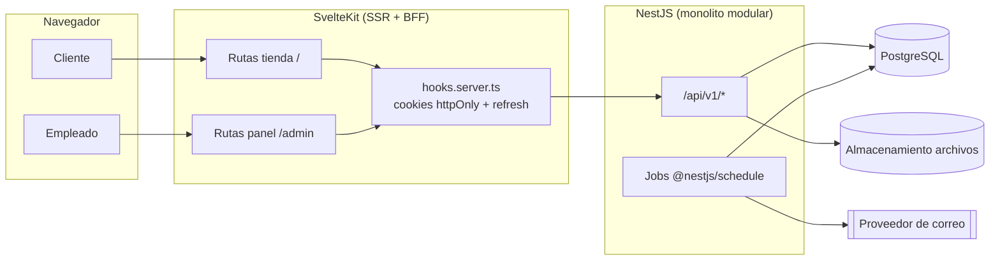

# Fase 1 · Arquitectura

> Estado: **propuesta pendiente de aprobación**. No existe código todavía.

## 1. Resumen

Farmacia en línea con dos interfaces (tienda y panel administrativo) en Guatemala, una bodega, precio único por producto, control por lotes/vencimientos (FEFO), pagos por transferencia y contra entrega, mensajería externa con seguimiento manual y modelo preparado para FEL.

| Capa | Tecnología | Nota |
|---|---|---|
| Backend | NestJS + TypeScript, API REST, Swagger | Un solo proceso, monolito modular |
| ORM | Prisma | Migraciones versionadas; SQL crudo solo para bloqueos (`FOR UPDATE`) y triggers |
| Base de datos | PostgreSQL (una BD) | Extensiones: `pg_trgm`, `unaccent`, `citext` |
| Frontend | SvelteKit + Svelte + TypeScript + Tailwind | Tienda y panel en la misma app |
| Tareas programadas | `@nestjs/schedule` (en proceso) | Expiración de reservas, reintentos de correo, alertas. Sin Redis |
| Rate limiting | `@nestjs/throttler` (memoria) | Suficiente para una instancia |
| Hash de contraseñas | argon2id | |
| Correo | nodemailer (SMTP) detrás de una interfaz `MailProvider` | Proveedor intercambiable |
| Archivos | Disco local (volumen) detrás de una interfaz `StorageProvider` | Migrable a S3 sin tocar módulos |

Las versiones exactas (Node LTS, NestJS, SvelteKit, Prisma, PostgreSQL) se fijan en la Fase 2.

## 2. Vista general



### Comunicación frontend ↔ backend (patrón BFF)

- El navegador **nunca** guarda tokens en `localStorage`. SvelteKit guarda el access token y el refresh token en **cookies httpOnly, Secure, SameSite=Lax** de su propio dominio.
- Las páginas usan `load` y *form actions* del lado del servidor de SvelteKit, que llaman a la API con `Authorization: Bearer`.
- `hooks.server.ts` renueva el access token con el refresh token cuando expira (rotación).
- La API mantiene CORS restringido al origen del frontend.
- Tipos de la API generados desde OpenAPI (`openapi-typescript`, dependencia de desarrollo) para mantener consistencia frontend/backend.

### Prefijos de la API

| Prefijo | Quién | Ejemplos |
|---|---|---|
| `/api/v1/auth` | Público / autenticado | login, registro, refresh, logout, recuperar contraseña |
| `/api/v1/store` | Público (catálogo) y clientes autenticados | productos, carrito, checkout, mis pedidos, direcciones |
| `/api/v1/admin` | Solo usuarios `STAFF` + permiso específico | todo el panel |

Un cliente nunca puede usar `/admin`: el guard verifica `user.type === 'STAFF'` **y** el permiso requerido en cada endpoint.

## 3. Módulos del backend

Cada módulo tiene su directorio, sus controladores (`*.store.controller.ts`, `*.admin.controller.ts`), servicios, DTOs y pruebas. Comparten `PrismaService`. La comunicación entre módulos es por inyección de servicios exportados (sin eventos distribuidos).

| Módulo | Responsabilidad | Depende de |
|---|---|---|
| `auth` | Login, JWT, refresh/rotación, recuperación de contraseña, guards | users |
| `users` | Usuarios administrativos, roles, permisos, bloqueo/desactivación | audit |
| `customers` | Registro de clientes, perfil, direcciones | users |
| `catalog` | Categorías, subcategorías, marcas, fabricantes, presentaciones, concentraciones, principios activos, etiquetas, productos, imágenes, búsqueda | files, audit |
| `inventory` | Bodega, lotes, movimientos, reservas FEFO, alertas de vencimiento y existencias | audit |
| `purchasing` | Proveedores, órdenes de compra, recepciones (transaccionales) | inventory, audit |
| `cart` | Carrito del cliente autenticado | catalog, pricing |
| `pricing` | Cálculo único de precios, promociones, impuestos, envío y totales | catalog, promotions, billing |
| `orders` | Checkout, pedidos, máquina de estados, historial, cancelaciones, devoluciones, recetas (condicional) | inventory, pricing, payments, shipping, notifications |
| `payments` | Cuentas bancarias, pagos (estrategia por método), verificación, cobro contra entrega, reembolsos | files, notifications, audit |
| `shipping` | Mensajerías, métodos de envío, envíos, eventos de seguimiento | notifications |
| `billing` | Tasas de impuesto, comprobantes/facturas, campos FEL | — |
| `promotions` | Promociones por porcentaje o monto fijo | catalog |
| `notifications` | Plantillas, bandeja de salida de correos, reintentos | — |
| `files` | Carga validada (tipo, tamaño, firma mágica, hash), descarga autorizada | — |
| `reports` | Dashboard e informes (consultas de solo lectura) | — |
| `settings` | Configuración de la farmacia y parámetros | files |
| `audit` | Registro de auditoría (append-only) | — |

`pricing` es el único lugar donde se calculan importes: el carrito muestra lo que `pricing` devuelve y el checkout vuelve a llamarlo dentro de la transacción.

### Extensibilidad prevista (sin implementar integraciones)

- **Pagos**: interfaz `PaymentMethodHandler` con implementaciones `BankTransferHandler` y `CashOnDeliveryHandler`. Una pasarela futura es otra implementación + valor de enum; `payments` ya guarda `provider` y `provider_reference`.
- **Mensajería**: `couriers.integration_code` + interfaz `CourierTrackingProvider`; hoy solo existe la carga manual de eventos (`source = MANUAL`).
- **FEL**: las columnas FEL ya existen en `invoices`; la interfaz del certificador se define cuando se elija proveedor.
- **Correo / archivos**: `MailProvider`, `StorageProvider`.

## 4. Estructura de carpetas

```
Desarrollo/
├── docker-compose.yml            # PostgreSQL para desarrollo y pruebas
├── .env.example
├── README.md
├── docs/
│   ├── fase-1/                   # este análisis
│   ├── api.md                    # índice; detalle en Swagger
│   ├── instalacion.md
│   ├── variables-entorno.md
│   ├── migraciones.md
│   ├── pruebas.md
│   ├── despliegue.md
│   └── decisiones/               # ADRs cortos (ADR-001-...)
├── backend/
│   ├── prisma/
│   │   ├── schema.prisma
│   │   ├── migrations/
│   │   └── seed.ts               # bodega, roles, permisos, IVA, admin inicial
│   ├── src/
│   │   ├── main.ts
│   │   ├── app.module.ts
│   │   ├── config/               # carga y validación de variables de entorno
│   │   ├── prisma/               # PrismaService, helpers de transacción
│   │   ├── common/
│   │   │   ├── decorators/       # @CurrentUser, @RequirePermissions, @Public
│   │   │   ├── guards/           # JwtAuthGuard, StaffGuard, PermissionsGuard, CustomerGuard
│   │   │   ├── filters/          # errores Prisma/negocio → HTTP
│   │   │   ├── dto/              # paginación, filtros comunes
│   │   │   └── utils/            # dinero (Decimal), fechas (America/Guatemala)
│   │   └── modules/
│   │       ├── auth/  users/  customers/
│   │       ├── catalog/          # un subdirectorio por catálogo (products/, categories/, ...)
│   │       ├── inventory/  purchasing/
│   │       ├── cart/  pricing/  orders/
│   │       ├── payments/methods/ # bank-transfer, cash-on-delivery
│   │       ├── shipping/  billing/  promotions/
│   │       ├── notifications/templates/
│   │       └── files/  reports/  settings/  audit/
│   └── test/                     # e2e contra PostgreSQL real
└── frontend/
    └── src/
        ├── hooks.server.ts       # sesión, refresh, protección /admin y /cuenta
        ├── lib/
        │   ├── server/           # cliente API (solo servidor), cookies
        │   ├── api/types.ts      # generado desde OpenAPI
        │   ├── components/
        │   │   ├── ui/           # Button, Input, Select, Modal, ConfirmDialog, DataTable,
        │   │   │                 # Pagination, Badge, Spinner, EmptyState, Alert, FileUpload
        │   │   ├── store/        # ProductCard, PriceTag, SaleConditionNotice, CartSummary...
        │   │   └── admin/        # Sidebar, PageHeader, FilterBar, StatCard...
        │   └── utils/            # formato GTQ, fechas, permisos
        └── routes/
            ├── (store)/          # inicio, catalogo, categorias/[slug], buscar,
            │                     # productos/[slug], carrito, checkout,
            │                     # cuenta/{perfil,direcciones,pedidos/[numero]}
            ├── (auth)/           # login, registro, recuperar, restablecer
            └── admin/
                ├── login/
                └── (panel)/      # layout con menú lateral + guard; una carpeta por sección:
                                  # dashboard, productos, categorias, subcategorias, marcas,
                                  # presentaciones, concentraciones, principios-activos,
                                  # clientes, usuarios, roles, proveedores, compras,
                                  # inventario, lotes, movimientos, pedidos, pagos, envios,
                                  # devoluciones, facturacion, promociones, reportes, configuracion
```

`backend/` y `frontend/` son dos paquetes independientes en el mismo repositorio (sin herramientas de monorepo adicionales).

## 5. Seguridad (diseño)

| Tema | Decisión |
|---|---|
| Access token | JWT, 15 min, claims `sub`, `typ` (CUSTOMER/STAFF), `sid` (sesión) |
| Refresh token | Opaco aleatorio (256 bits), 30 días cliente / 12 h staff, guardado **hasheado** en `sessions`; rotación en cada uso y revocación de la cadena si se detecta reutilización |
| Permisos | `@RequirePermissions('orders.update')` + `PermissionsGuard` contra BD. El frontend solo oculta menús; el backend decide |
| Bloqueo | Tras N intentos fallidos → `locked_until`. Usuario `BLOCKED`/`INACTIVE` no inicia sesión y sus sesiones se revocan |
| Recuperación | Token de un solo uso, hasheado, 30 min; misma respuesta exista o no el correo |
| Validación | `ValidationPipe` global con `whitelist` + `forbidNonWhitelisted` + `transform` |
| Inyección SQL | Prisma parametrizado; SQL crudo solo con `$queryRaw` etiquetado (nunca `$queryRawUnsafe`) |
| Archivos | Lista blanca (JPEG, PNG, WebP, PDF), tamaño máximo configurable, verificación de firma mágica, nombre aleatorio, fuera del directorio público, descarga autorizada para comprobantes/recetas. Imágenes de producto públicas |
| Cabeceras | `helmet`, CORS con origen explícito, rate limiting estricto en login, registro, recuperación y checkout |
| Importes | Precios, descuentos, impuestos, envío y totales siempre calculados en `pricing`; el frontend no envía importes |

## 6. Pruebas (estrategia)

- **Unitarias (Jest)**: `pricing`, máquinas de estado de pedidos y pagos, selección FEFO, validación de archivos.
- **Integración/e2e (Jest + Supertest)** contra PostgreSQL real (docker), porque las reglas críticas dependen de transacciones, bloqueos y restricciones: recepción de compras, reservas, checkouts concurrentes, devoluciones, reembolsos, permisos.
- **Frontend**: Vitest para utilidades/componentes; Playwright para registro → carrito → checkout y verificación de pago en el panel.

## 7. Despliegue (propuesta inicial)

Un servidor (VPS) con Docker Compose: `postgres`, `backend`, `frontend` (adapter-node) y proxy inverso con TLS (Caddy o Nginx). Respaldos diarios de PostgreSQL y del volumen de archivos. Si en el futuro hay más de una instancia del backend, los jobs usarán `pg_try_advisory_lock` para no duplicarse (sin Redis).
