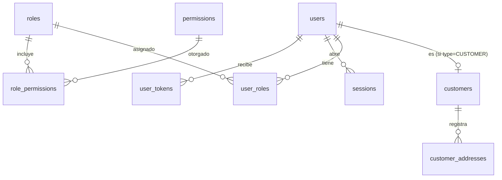
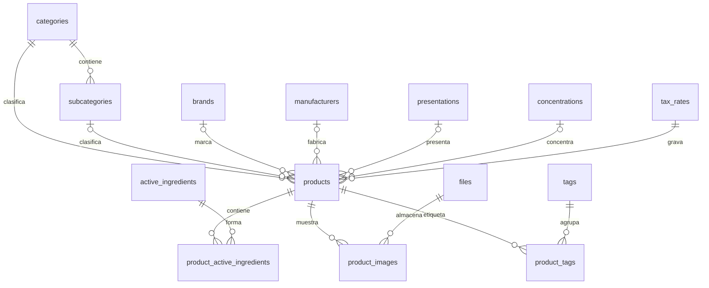
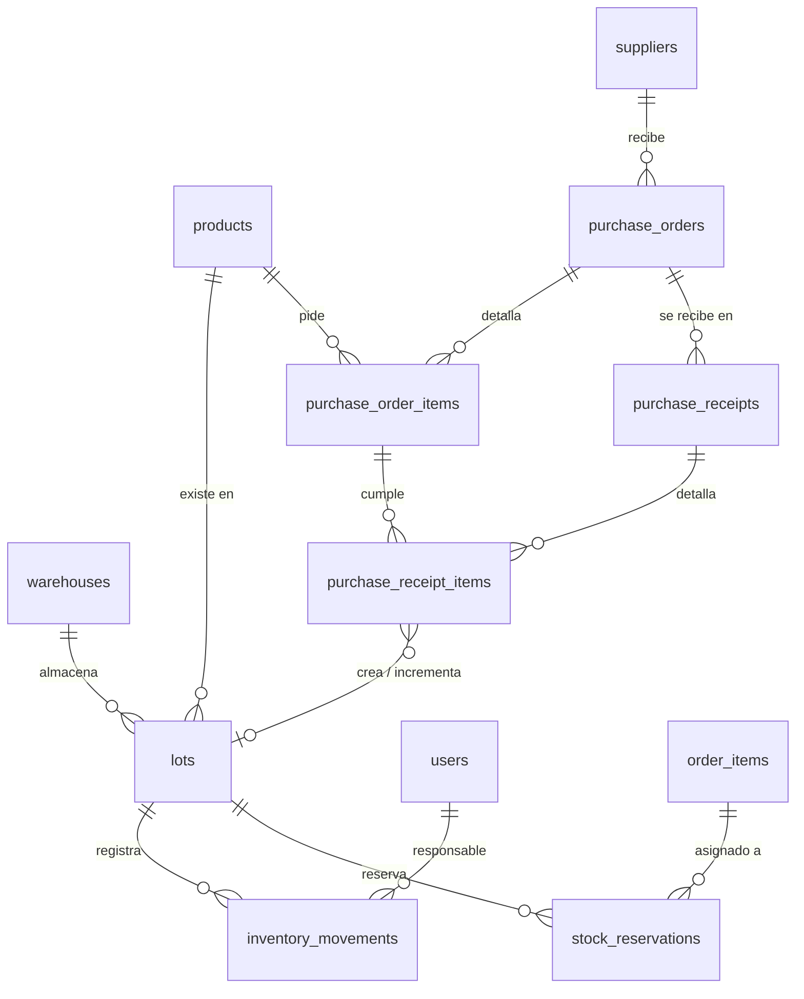
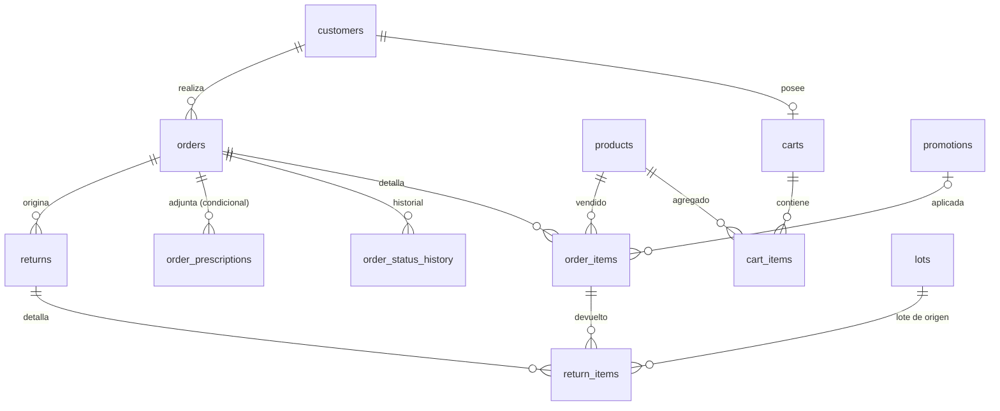
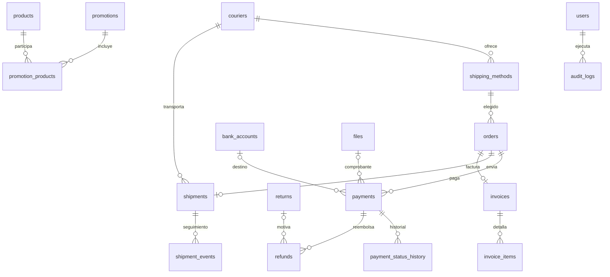

# Fase 1 · Modelo de datos (PostgreSQL)

> Estado: **propuesta pendiente de aprobación**.

## 1. Convenciones

| Tema | Convención |
|---|---|
| Nombres | Tablas y columnas en inglés, `snake_case`, plural (`products`). Prisma mapea a modelos en `PascalCase` con `@@map`/`@map` |
| Claves primarias | `id UUID` (generado por Prisma, v7 ordenable). Tablas puente con PK compuesta |
| Números visibles | Documentos con número correlativo legible desde secuencias: `PED-000123`, `OC-000045`, `REC-000045`, `DEV-000012` |
| Dinero | `DECIMAL(12,2)`; costos unitarios `DECIMAL(12,4)`; tasas `DECIMAL(5,4)`. Nunca `float` |
| Cantidades | `INTEGER` en unidades de venta del producto |
| Fechas | `TIMESTAMPTZ` para eventos; `DATE` para vencimientos. Zona de negocio: `America/Guatemala` |
| Auditoría de filas | `created_at`, `updated_at` en todas las tablas mutables |
| Eliminación lógica | `deleted_at` en catálogos, proveedores, usuarios, direcciones, cuentas bancarias, mensajerías, promociones. Los documentos transaccionales (pedidos, pagos, compras, movimientos) **nunca** se eliminan: se cancelan o se compensan |
| Enums | Enums de PostgreSQL vía Prisma |
| FKs | `ON DELETE RESTRICT` por defecto; `CASCADE` solo para hijos puramente dependientes (líneas de carrito, tablas puente, imágenes) |

**Total: 55 tablas** en 12 dominios (una condicional: `order_prescriptions`).

## 2. Diagramas entidad-relación

Se muestran por dominio; los atributos completos están en la sección 3.

### 2.1 Usuarios y seguridad

### 2.2 Catálogo

### 2.3 Inventario y compras

### 2.4 Carrito, pedidos, devoluciones

### 2.5 Pagos, envíos, facturación y transversales

## 3. Tablas

Notación: **PK**, **FK**, **UQ** (único), `?` = nullable.

### 3.1 Usuarios y seguridad (9)

**users** — Cuenta de acceso, tanto clientes como personal.
`id` PK · `email` CITEXT UQ · `password_hash` · `type` enum(`CUSTOMER`,`STAFF`) · `status` enum(`ACTIVE`,`BLOCKED`,`INACTIVE`) · `first_name` · `last_name` · `phone?` · `email_verified_at?` · `failed_login_attempts` int · `locked_until?` · `last_login_at?` · `created_at` · `updated_at` · `deleted_at?`

**roles** — Rol administrativo. `id` PK · `code` UQ · `name` · `description?` · `is_system` bool (no editable/eliminable) · timestamps.

**permissions** — Catálogo fijo sembrado por código (`módulo.acción`, p. ej. `inventory.adjust`, `payments.verify`). `id` PK · `code` UQ · `module` · `description`.

**role_permissions** — PK(`role_id`,`permission_id`), ambos FK CASCADE.

**user_roles** — PK(`user_id`,`role_id`). Solo usuarios `STAFF` (validado en servicio).

**customers** — Datos de cliente 1:1 con `users`. `user_id` PK/FK · `tax_id` (NIT, por defecto `CF`) · `tax_name?` (nombre para facturación) · `birth_date?` · timestamps.

**customer_addresses** — `id` PK · `customer_id` FK · `label` · `recipient_name` · `phone` · `address_line1` · `address_line2?` · `zone?` (zona) · `municipality` · `department` · `reference?` · `is_default` bool · timestamps · `deleted_at?`.

**sessions** — Refresh tokens. `id` PK · `user_id` FK · `token_hash` UQ · `user_agent?` · `ip?` · `expires_at` · `revoked_at?` · `replaced_by_id?` FK self · `created_at`.

**Doble factor (agregado en la Fase 3, ADR-003):** `users` suma `totp_secret?` (cifrado AES-256-GCM), `totp_enabled_at?` y `totp_last_step?`. Tablas nuevas: **mfa_challenges** — `id` · `user_id` FK · `token_hash` UQ · `attempts` · `expires_at` · `consumed_at?` · `created_at`; **user_recovery_codes** — `id` · `user_id` FK · `code_hash` · `used_at?` · `created_at`, UQ(`user_id`,`code_hash`). Además se omitió `users.deleted_at` (baja lógica con `status = INACTIVE`, ADR-002).

**user_tokens** — Tokens de un solo uso. `id` PK · `user_id` FK · `purpose` enum(`PASSWORD_RESET`,`EMAIL_VERIFICATION`) · `token_hash` UQ · `expires_at` · `used_at?` · `created_at`.

### 3.2 Catálogo (12)

Catálogos simples (`brands`, `manufacturers`, `presentations`, `active_ingredients`, `tags`): `id` PK · `name` UQ (sobre activos) · `slug?` · `is_active` · timestamps · `deleted_at?`.

**categories** — `id` · `name` · `slug` UQ · `description?` · `image_file_id?` FK · `sort_order` · `is_active` · timestamps · `deleted_at?`.

**subcategories** — `id` · `category_id` FK · `name` · `slug` · `sort_order` · `is_active` · timestamps · `deleted_at?`. UQ(`category_id`,`slug`) y UQ(`id`,`category_id`) para la FK compuesta de productos.

**concentrations** — `id` · `label` UQ (texto mostrado: "500 mg", "5 %", "875 mg + 125 mg") · `value?` DECIMAL · `unit?` · timestamps. `value/unit` opcionales para permitir combinaciones.

**products**

| Columna | Tipo | Nota |
|---|---|---|
| `id` | UUID PK | |
| `sku` | text UQ | |
| `barcode?` | text UQ parcial (no nulos) | |
| `name` | text | Nombre comercial |
| `slug` | text UQ | URL |
| `short_description?`, `description?` | text | |
| `category_id` | FK | obligatorio |
| `subcategory_id?` | FK compuesta (`subcategory_id`,`category_id`) → subcategories | garantiza que la subcategoría pertenece a la categoría |
| `brand_id?`, `manufacturer_id?`, `presentation_id?`, `concentration_id?` | FK | opcionales |
| `sanitary_registration?` | text | Registro sanitario |
| `sanitary_registration_expires_at?` | date | |
| `price` | DECIMAL(12,2) | Precio único, `CHECK (price > 0)` |
| `tax_rate_id` | FK → tax_rates | |
| `sale_condition` | enum | `OTC` (venta libre), `PRESCRIPTION` (receta), `RETAINED_PRESCRIPTION` (receta retenida), `CONTROLLED` (controlado) |
| `requires_prescription` | bool generado | `sale_condition <> 'OTC'` (columna generada, no editable) |
| `online_sale_enabled` | bool, default false | Habilitación regulatoria para vender en línea |
| `online_sale_approved_by?`, `online_sale_approved_at?` | FK users, timestamptz | quién verificó la legalidad |
| `low_stock_threshold` | int, default 0 | |
| `is_active` | bool | |
| `search_vector` | tsvector generado | nombre + SKU + código de barras |
| timestamps, `deleted_at?` | | |

`CHECK`: si `sale_condition = 'CONTROLLED'` entonces `online_sale_enabled = false` (los controlados no se venden en línea en v1).
"Disponibilidad" no se almacena: se calcula desde los lotes.

**product_active_ingredients** — PK(`product_id`,`active_ingredient_id`) · `sort_order`. Permite medicamentos combinados; productos sin principio activo no tienen filas.

**product_images** — `id` · `product_id` FK CASCADE · `file_id` FK · `alt_text?` · `sort_order` · `is_primary` bool. UQ parcial (`product_id`) WHERE `is_primary`.

**product_tags** — PK(`product_id`,`tag_id`).

**Ajustes de la Fase 4 (ADR-004):** `products.requires_prescription` no se guarda (se calcula desde `sale_condition`); `search_vector` se reemplazó por índices de trigramas sobre `immutable_unaccent(name)`, `sku`, marca y principio activo; la concentración usa `name` como etiqueta visible (sin `value`/`unit`); los `slug` son únicos solo entre registros vigentes. `files` y `tax_rates` se crearon en esta fase.

### 3.3 Inventario (4)

**warehouses** — Una sola fila sembrada. `id` · `code` UQ · `name` · `address?` · timestamps. (No hay UI para crear bodegas.)

**lots** — Existencia por producto y lote; es la tabla de existencias.

| Columna | Nota |
|---|---|
| `id` PK | |
| `product_id` FK, `warehouse_id` FK | |
| `lot_number` | Productos sin lote del fabricante usan un lote generado |
| `expiration_date?` DATE | Nulo solo para productos no perecederos |
| `manufacturing_date?` DATE | |
| `status` enum | `AVAILABLE`, `QUARANTINE`, `RECALLED` (retiro del mercado), `BLOCKED` |
| `status_reason?` | |
| `qty_on_hand` int | Existencia física |
| `qty_reserved` int | Existencia reservada |
| `avg_unit_cost` DECIMAL(12,4) | Costo promedio del lote |
| `first_received_at` | |
| timestamps | |

UQ(`product_id`,`lot_number`). `CHECK (qty_on_hand >= 0 AND qty_reserved >= 0 AND qty_reserved <= qty_on_hand)` — última defensa contra existencias negativas o sobre-reserva.

Conceptos derivados (vista `v_product_stock`, sin tablas redundantes):

| Concepto | Cálculo |
|---|---|
| Física | `SUM(qty_on_hand)` |
| Reservada | `SUM(qty_reserved)` |
| Vencida | `SUM(qty_on_hand)` donde `expiration_date < hoy` |
| En cuarentena | `SUM(qty_on_hand)` donde `status = 'QUARANTINE'` (+ unidades devueltas pendientes de inspección) |
| Disponible | `SUM(qty_on_hand - qty_reserved)` donde `status = 'AVAILABLE'` y (`expiration_date IS NULL` o `expiration_date >= hoy + días_mínimos_de_vida_útil`) |

"Vencido" se calcula por fecha, no por estado, para que nunca quede desactualizado.

**inventory_movements** — Kardex inmutable.
`id` PK · `number` UQ · `lot_id` FK · `product_id` FK (desnormalizado para consultas) · `type` enum(`PURCHASE_RECEIPT`, `SALE`, `ADJUSTMENT_IN`, `ADJUSTMENT_OUT`, `RETURN_RESTOCK`, `WRITE_OFF`, `RETURN_TO_SUPPLIER`) · `quantity` int con signo (`CHECK quantity <> 0`, signo coherente con el tipo) · `balance_after` int · `unit_cost` DECIMAL(12,4) · `reason_code?` (VENCIDO, DAÑADO, RETIRO, CONTEO, ERROR_REGISTRO…) · `notes?` · `reference_type?` (`ORDER`, `PURCHASE_RECEIPT`, `RETURN`, `MOVEMENT`) · `reference_id?` · `user_id` FK (responsable) · `created_at`.
Trigger que rechaza `UPDATE` y `DELETE`. Un error se corrige con un movimiento de ajuste que referencia al original (`reference_type = 'MOVEMENT'`).

**stock_reservations** — Asignación FEFO de lotes a líneas de pedido; también es la trazabilidad venta → lote.
`id` · `order_item_id` FK · `lot_id` FK · `quantity` int `CHECK > 0` · `status` enum(`ACTIVE`, `CONSUMED`, `RELEASED`, `EXPIRED`) · `expires_at?` · `consumed_movement_id?` FK → inventory_movements · `created_at` · `updated_at`.

**Ajustes de la Fase 5 (ADR-005):** `purchase_receipts` no tiene estado (una recepción registrada es definitiva); `purchase_receipt_items` guarda `lot_id` y `movement_id` obligatorios. `inventory_movements.number` es un correlativo. `store_settings` solo tiene por ahora los parámetros de inventario.

**Ajustes de la Fase 6 (ADR-006):** `store_settings` suma los datos de la farmacia, la información regulatoria y los parámetros de pedidos (`transfer_reservation_hours`, `cod_reservation_hours`, `max_units_per_product`). `shipping_methods` tiene `deleted_at` y su `courier_id` se agrega en la Fase 7. `orders` agrega `shipping_tax`; `idempotency_key` es única por cliente; las columnas de cancelación llegan en la Fase 7. `stock_reservations` no guarda `expires_at` (el plazo vive en `orders.reservation_expires_at`) y `consumed_movement_id` se agrega con el despacho (Fase 7). `order_items.promotion_id` y `quantity_returned` se agregan en las Fases 8 y 7. `payments` tiene por ahora solo las columnas comunes; las de transferencia y cobro llegan en la Fase 7.

**Ajustes de la Fase 7 (ADR-007):** `shipments.status` no tiene `PENDING` ni `READY`, porque el envío se crea al despachar; la preparación es el estado `PREPARING` del pedido. `shipment_events` es de solo inserción. `returns` registra quién decidió (`decided_by`/`decided_at`) en lugar de `approved_by`, y guarda el motivo de rechazo. `payments` agrega `submitted_at` y `collection_note`. Los `*_by` de personal guardan el id del usuario sin clave foránea, como en compras.

**Ajustes de la Fase 8 (ADR-008):** `invoices.internal_number` es `number` (correlativo, se muestra CI-000001) y `invoices.status` solo tiene `ISSUED` y `VOIDED` (sin borrador: se emite en la transacción del pago). `fel_status` es `PENDING`, `CERTIFIED` o `NOT_APPLICABLE`; `ERROR` y `CANCELLED` se agregarán con la integración de un certificador. No se guardan aún el XML y el PDF de la FEL. Se agregan `issued_by`, `voided_*` y `fel_registered_by`.

### 3.4 Compras (5)

**suppliers** — `id` · `name` · `tax_id?` (NIT) · `contact_name?` · `phone?` · `email?` · `address?` · `notes?` · `is_active` · timestamps · `deleted_at?`.

**purchase_orders** — `id` · `number` UQ · `supplier_id` FK · `status` enum(`DRAFT`, `APPROVED`, `PARTIALLY_RECEIVED`, `RECEIVED`, `CLOSED`, `CANCELLED`) · `order_date` · `expected_date?` · `subtotal` · `tax_total` · `total` · `notes?` · `created_by` FK · `approved_by?` FK · `approved_at?` · timestamps.

**purchase_order_items** — `id` · `purchase_order_id` FK · `product_id` FK · `quantity_ordered` `CHECK > 0` · `quantity_received` default 0, `CHECK (quantity_received <= quantity_ordered)` · `unit_cost` DECIMAL(12,4) · `tax_rate` DECIMAL(5,4) · `line_subtotal` · `line_tax` · `line_total`. UQ(`purchase_order_id`,`product_id`).

**purchase_receipts** — `id` · `number` UQ · `purchase_order_id` FK · `status` enum(`DRAFT`, `CONFIRMED`, `CANCELLED`) · `supplier_invoice_number?` · `received_at` · `received_by` FK · `confirmed_at?` · `notes?` · timestamps. Una recepción `CONFIRMED` es inmutable.

**purchase_receipt_items** — "Lotes recibidos". `id` · `receipt_id` FK · `purchase_order_item_id` FK · `product_id` FK · `lot_number` · `expiration_date?` · `manufacturing_date?` · `quantity` `CHECK > 0` · `unit_cost` · `initial_status` enum(`AVAILABLE`,`QUARANTINE`) · `lot_id?` FK (se llena al confirmar) · `movement_id?` FK.

### 3.5 Carrito (2)

**carts** — `id` · `customer_id` FK UQ · timestamps.
**cart_items** — `id` · `cart_id` FK CASCADE · `product_id` FK · `quantity` `CHECK > 0` · timestamps. UQ(`cart_id`,`product_id`). **No guarda precios.**

### 3.6 Pedidos y devoluciones (6)

**orders**

| Grupo | Columnas |
|---|---|
| Identidad | `id`, `number` UQ, `customer_id` FK, `idempotency_key` UQ (evita pedidos duplicados por doble clic) |
| Estado | `status` enum (ver reglas de negocio), `placed_at`, `reservation_expires_at?`, `cancelled_at?`, `cancel_reason?`, `cancelled_by?` |
| Copia del cliente | `customer_name`, `customer_email`, `customer_phone`, `billing_tax_id`, `billing_name` |
| Copia de entrega | `ship_recipient_name`, `ship_phone`, `ship_address_line1`, `ship_address_line2?`, `ship_zone?`, `ship_municipality`, `ship_department`, `ship_reference?`, `customer_address_id?` FK (solo referencia) |
| Envío | `shipping_method_id` FK, `shipping_method_name` (copia), `shipping_cost` |
| Pago | `payment_method` enum(`BANK_TRANSFER`,`CASH_ON_DELIVERY`) |
| Importes | `currency` (GTQ), `subtotal`, `discount_total`, `tax_total`, `total` — todos calculados en backend |
| Otros | `customer_notes?`, `requires_prescription_review` bool, timestamps |

`CHECK (total = subtotal - discount_total + shipping_cost)` (con precios con IVA incluido; ver decisión D1).

**order_items** — Copia comercial inmutable de cada línea.
`id` · `order_id` FK · `product_id` FK · `sku` · `product_name` · `presentation_label?` · `concentration_label?` · `sale_condition` · `unit_price` (precio normal) · `unit_discount` · `promotion_id?` FK · `tax_rate` · `quantity` `CHECK > 0` · `line_subtotal` · `line_discount` · `line_tax` · `line_total` · `quantity_returned` default 0 `CHECK (quantity_returned <= quantity)`.

**order_status_history** — `id` · `order_id` FK · `from_status?` · `to_status` · `changed_by?` FK users (nulo = sistema) · `note?` · `created_at`. Solo inserción.

**order_prescriptions** *(condicional, ver D2)* — `id` · `order_id` FK · `file_id` FK · `status` enum(`PENDING`,`APPROVED`,`REJECTED`) · `reviewed_by?` FK · `reviewed_at?` · `review_notes?` · `created_at`.

**returns** — `id` · `number` UQ · `order_id` FK · `status` enum(`REQUESTED`, `APPROVED`, `REJECTED`, `RECEIVED`, `CLOSED`) · `reason` · `created_by` FK · `approved_by?` · `received_by?` · `received_at?` · `notes?` · timestamps.

**return_items** — `id` · `return_id` FK · `order_item_id` FK · `lot_id` FK (desde la reserva consumida) · `quantity` `CHECK > 0` · `condition_notes?` · `disposition` enum(`PENDING_INSPECTION`, `RESTOCK`, `DESTROY`, `RETURN_TO_SUPPLIER`) · `inspected_by?` · `inspected_at?` · `movement_id?` FK (solo si se reincorpora).

### 3.7 Pagos (4)

**bank_accounts** — `id` · `bank_name` · `account_number` · `account_type` · `account_holder` · `currency` · `instructions?` · `is_active` · `sort_order` · timestamps · `deleted_at?`.

**payments** — Un pedido puede tener varios intentos (p. ej. comprobante rechazado y luego uno nuevo).
`id` · `order_id` FK · `method` enum · `status` enum(`PENDING`, `IN_REVIEW`, `APPROVED`, `REJECTED`, `CANCELLED`, `REFUNDED`, `PARTIALLY_REFUNDED`) · `amount` (esperado) · `currency` · `provider` (`MANUAL` hoy) · `provider_reference?` · Transferencia: `bank_account_id?` FK, `bank_reference?`, `transfer_date?`, `proof_file_id?` FK · Contra entrega: `collected_amount?`, `collected_by?` FK, `collected_at?` · Verificación: `verified_by?` FK, `verified_at?`, `rejection_reason?` · timestamps.
Índice único parcial: un solo pago vigente por pedido — UQ(`order_id`) WHERE `status IN ('PENDING','IN_REVIEW','APPROVED')`.
UQ parcial (`bank_account_id`,`bank_reference`) para detectar comprobantes reutilizados.

**payment_status_history** — `id` · `payment_id` FK · `from_status?` · `to_status` · `changed_by?` · `note?` · `created_at`.

**refunds** — `id` · `payment_id` FK · `return_id?` FK · `amount` `CHECK > 0` · `method` enum(`BANK_TRANSFER`,`CASH`) · `reference?` · `reason` · `status` enum(`PENDING`,`COMPLETED`,`CANCELLED`) · `processed_by?` · `processed_at?` · timestamps. La suma de reembolsos completados ≤ monto aprobado del pago (validado en transacción con bloqueo del pago).

### 3.8 Envíos (4)

**couriers** — `id` · `name` · `phone?` · `website?` · `tracking_url_template?` (`https://.../rastreo?guia={tracking}`) · `integration_code?` (futuro) · `is_active` · timestamps · `deleted_at?`.

**shipping_methods** — Tipo de envío ofrecido al cliente. `id` · `courier_id?` FK · `name` · `description?` · `cost` DECIMAL(12,2) · `estimated_days_min?` · `estimated_days_max?` · `coverage_note?` · `allows_cash_on_delivery` bool · `is_active` · `sort_order` · timestamps.

**shipments** — `id` · `order_id` FK UQ (un envío por pedido) · `courier_id` FK · `tracking_number?` · `courier_cost?` (costo real de la mensajería) · `status` enum(`PENDING`, `READY`, `DISPATCHED`, `IN_TRANSIT`, `DELIVERED`, `FAILED`, `RETURNED`) · `dispatched_at?` · `delivered_at?` · `received_by_name?` · `notes?` · timestamps. UQ parcial (`courier_id`,`tracking_number`).

**shipment_events** — `id` · `shipment_id` FK · `status` · `description` · `location?` · `occurred_at` · `source` enum(`MANUAL`,`API`) · `created_by?` FK · `created_at`.

### 3.9 Facturación (3)

**tax_rates** — `id` · `code` UQ (`IVA`, `EXENTO`) · `name` · `rate` DECIMAL(5,4) · `is_default` · `is_active` · timestamps.

**invoices** — Documento asociado al pedido.
`id` · `order_id` FK UQ · `kind` enum(`INTERNAL_RECEIPT`, `FEL`) · `status` enum(`DRAFT`, `ISSUED`, `VOIDED`) · `internal_number` UQ · `issued_at?` · `customer_tax_id` · `customer_name` · `customer_address?` · `subtotal` · `tax_total` · `total` · `currency` ·
FEL (nulos hasta la integración): `fel_status` enum(`NOT_APPLICABLE`, `PENDING`, `CERTIFIED`, `ERROR`, `CANCELLED`) · `fel_authorization_uuid?` UQ · `fel_series?` · `fel_number?` · `fel_certifier?` · `fel_certified_at?` · `fel_xml_file_id?` · `fel_pdf_file_id?` · `fel_last_error?` · timestamps.
El comprobante `INTERNAL_RECEIPT` lleva la leyenda "Documento interno — no constituye factura ni documento tributario".

**invoice_items** — `id` · `invoice_id` FK · `order_item_id?` FK · `description` · `quantity` · `unit_price` · `discount` · `tax_amount` · `line_total` · `is_good` bool (bien/servicio, requerido por FEL; envío = servicio).

### 3.10 Promociones (2)

**promotions** — `id` · `name` · `description?` · `type` enum(`PERCENTAGE`,`FIXED_AMOUNT`) · `value` DECIMAL(12,2) · `starts_at` · `ends_at` · `is_active` · `created_by` FK · timestamps · `deleted_at?`.
`CHECK (ends_at > starts_at)`, `CHECK (value > 0)`, `CHECK (type <> 'PERCENTAGE' OR value <= 100)`.

**promotion_products** — PK(`promotion_id`,`product_id`).

### 3.11 Transversales (4)

**files** — `id` · `storage_key` UQ · `original_name` · `mime_type` · `size_bytes` · `sha256` · `purpose` enum(`PRODUCT_IMAGE`, `CATEGORY_IMAGE`, `PAYMENT_PROOF`, `PRESCRIPTION`, `LOGO`, `FEL_DOCUMENT`) · `is_public` bool · `uploaded_by?` FK · `created_at`.

**notification_logs** — Bandeja de salida de correo (outbox en la misma BD). `id` · `type` (ORDER_CONFIRMED, TRANSFER_APPROVED…) · `recipient` · `subject` · `payload` JSONB · `status` enum(`PENDING`,`SENT`,`FAILED`) · `attempts` · `last_error?` · `sent_at?` · `related_type?` · `related_id?` · `created_at`.

**store_settings** — Fila única (`CHECK id = 1`), columnas tipadas: `trade_name` · `legal_name` · `tax_id` · `fiscal_address` · `logo_file_id?` · `phone` · `email` · `whatsapp?` · `currency` (GTQ) · `timezone` · `prices_include_tax` bool · `near_expiry_days` (p. ej. 90) · `min_shelf_life_days_for_sale` (p. ej. 30) · `transfer_reservation_hours` · `cod_reservation_hours` · `max_failed_logins` · `notification_from_email` · `staff_alert_email?` · `updated_by` · `updated_at`.

**Ajustes de la Fase 9 (ADR-009):** `notification_logs.type` es un enum (`ORDER_PLACED`, `ORDER_STATUS_CHANGED`, `STAFF_TRANSFER_TO_VERIFY`, `STAFF_INVENTORY_DIGEST`); se agregan `next_attempt_at`, `dedupe_key` y `updated_at`, y `subject` se completa al enviar. `audit_logs` guarda `route` y `status_code`; `entity` se reemplaza por `module` + `route` y `action` es el nombre de la operación (o `LOGIN`, `LOGIN_FAILED`, `ACCOUNT_LOCKED`).

**audit_logs** — Solo inserción (trigger anti `UPDATE`/`DELETE`). `id` BIGSERIAL · `user_id?` FK · `action` (CREATE, UPDATE, DELETE, APPROVE, REJECT, STATUS_CHANGE, LOGIN…) · `module` · `entity` · `entity_id` · `changes` JSONB (antes/después de los campos modificados) · `ip?` · `user_agent?` · `created_at`.

## 4. Reglas de integridad (resumen)

1. FKs en todas las relaciones; `RESTRICT` por defecto para no perder historial.
2. Subcategoría coherente con la categoría del producto (FK compuesta).
3. `CHECK` de existencias en `lots`: nunca negativas, reservado ≤ físico.
4. `inventory_movements` y `audit_logs` inmutables por trigger.
5. Recepciones confirmadas, pedidos y pagos no se eliminan; solo cambian de estado con historial.
6. Un solo pago vigente por pedido (índice único parcial).
7. `quantity_received ≤ quantity_ordered`, `quantity_returned ≤ quantity`.
8. `CHECK` de precios y montos positivos, porcentajes ≤ 100, fechas de promoción coherentes.
9. Controlados no habilitables para venta en línea (`CHECK`).
10. Unicidad: email, SKU, código de barras, slug, número de documento, lote por producto, número de guía por mensajería, referencia bancaria por cuenta, `idempotency_key`.
11. `store_settings` fila única.
12. La coherencia `lots.qty_on_hand = Σ movements.quantity` se garantiza actualizando ambos en la misma transacción y se verifica con una consulta de conciliación en las pruebas.

## 5. Índices propuestos

| Tabla | Índice | Uso |
|---|---|---|
| products | GIN (`search_vector`); GIN trigram (`unaccent(name)`) | Búsqueda por nombre tolerante a errores |
| products | (`category_id`, `is_active`), (`subcategory_id`), (`brand_id`) | Filtros del catálogo |
| products | UQ `sku`; UQ parcial `barcode` | Búsqueda exacta |
| product_active_ingredients | (`active_ingredient_id`) | Búsqueda por principio activo |
| lots | (`product_id`, `status`, `expiration_date`) | Selección FEFO y disponibilidad |
| lots | (`expiration_date`) WHERE `qty_on_hand > 0` | Vencidos / próximos a vencer |
| inventory_movements | (`lot_id`, `created_at`), (`product_id`, `created_at`), (`reference_type`, `reference_id`), (`type`, `created_at`) | Kardex e informes |
| stock_reservations | (`expires_at`) WHERE `status = 'ACTIVE'`; (`order_item_id`); (`lot_id`) | Job de expiración, trazabilidad |
| orders | (`customer_id`, `placed_at` DESC), (`status`, `placed_at`), (`placed_at`) | Historial del cliente, panel, reportes |
| order_items | (`order_id`), (`product_id`) | Más vendidos |
| order_status_history, payment_status_history | (`order_id`/`payment_id`, `created_at`) | |
| payments | (`status`, `created_at`), (`order_id`) | Pagos pendientes de verificación |
| shipments | (`status`) | |
| purchase_orders | (`supplier_id`, `order_date`), (`status`) | |
| sessions | (`user_id`) WHERE `revoked_at IS NULL` | |
| audit_logs | (`entity`, `entity_id`), (`user_id`, `created_at`), (`module`, `created_at`) | |
| notification_logs | (`status`, `created_at`) WHERE `status <> 'SENT'` | Reintentos |
| customer_addresses | (`customer_id`) WHERE `deleted_at IS NULL` | |

Los índices parciales, GIN, columnas generadas y triggers se agregan en migraciones SQL personalizadas de Prisma.
