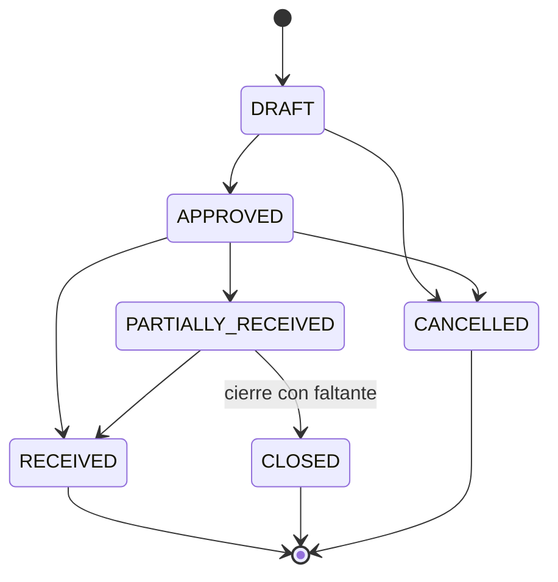
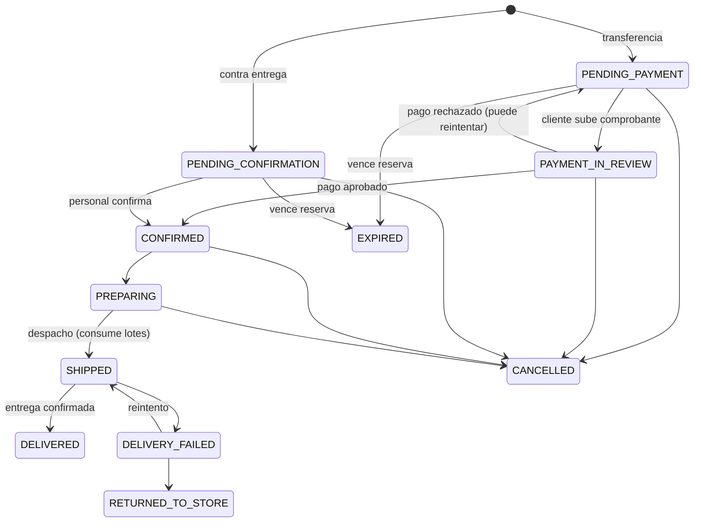
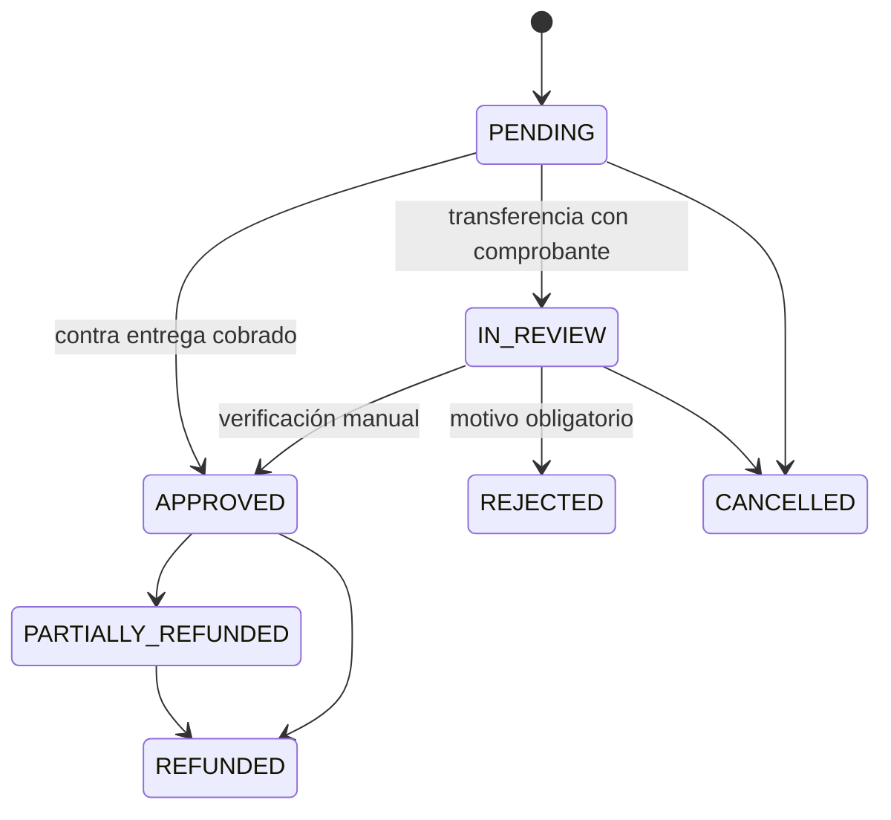

# Fase 1 · Reglas de negocio

> Estado: **propuesta pendiente de aprobación**. Los valores marcados con *(D#)* dependen de una decisión pendiente (ver `04-decisiones-y-riesgos.md`).

## 1. Producto vendible

Un producto se puede agregar al carrito y comprar solo si **todas** se cumplen:

1. `is_active = true` y `deleted_at IS NULL`.
2. `online_sale_enabled = true` (verificación regulatoria registrada con usuario y fecha).
3. `sale_condition = 'OTC'`, o la venta con receta está habilitada *(D2)* y se adjunta receta aprobada.
4. `sale_condition <> 'CONTROLLED'` (nunca en línea en v1).
5. Existencia disponible > 0 (ver §2).

Los productos que no cumplen 2–4 pueden mostrarse en el catálogo como informativos ("Venta solo en farmacia" / "Requiere receta"), sin botón de compra. El sistema no recomienda medicamentos, no sugiere sustitutos ni muestra contenido de diagnóstico o tratamiento.

## 2. Inventario

- **Lote elegible para venta**: `status = 'AVAILABLE'` y (`expiration_date IS NULL` o `expiration_date >= hoy + min_shelf_life_days_for_sale`) *(D4)* y `qty_on_hand - qty_reserved > 0`.
- **FEFO**: los lotes elegibles se ordenan por `expiration_date ASC NULLS LAST, first_received_at ASC, id ASC`; una línea puede repartirse entre varios lotes.
- **Vencidos**: se detectan por fecha. Un job diario genera alertas; la baja se hace con un movimiento `WRITE_OFF` (motivo VENCIDO) registrado por un usuario.
- **Cuarentena / retiro**: cambiar un lote a `QUARANTINE`, `RECALLED` o `BLOCKED` lo saca de la venta de inmediato. Si tiene reservas activas, el cambio exige decidir: reasignar a otro lote por FEFO (si hay) o dejar el pedido en espera para gestión manual. Cada cambio de estado se audita.
- **Movimientos**: cada cambio de `qty_on_hand` crea un movimiento en la misma transacción, con usuario responsable. Nunca se editan ni se eliminan; se compensan con ajustes que referencian al original.
- **Ajustes**: requieren permiso `inventory.adjust`, motivo obligatorio y nunca dejan existencias negativas.
- **Alertas**: existencias bajas (`disponible ≤ low_stock_threshold`), próximos a vencer (`expiration_date ≤ hoy + near_expiry_days`) *(D4)*, vencidos con existencia, lotes en cuarentena.

## 3. Compras

Estados de orden de compra:

**Confirmar una recepción** (una sola transacción):

1. Bloquear la orden de compra y sus líneas.
2. Validar que cada cantidad recibida ≤ pendiente de la línea, y que los medicamentos traen número de lote y fecha de vencimiento futura.
3. Por cada línea: crear el lote o incrementar uno existente (mismo producto y número de lote; la fecha de vencimiento debe coincidir), recalcular `avg_unit_cost`, crear el movimiento `PURCHASE_RECEIPT`.
4. El estado inicial del lote es el elegido en la recepción (`AVAILABLE` o `QUARANTINE`) *(D6)*.
5. Actualizar `quantity_received` y el estado de la orden.
6. Registrar auditoría.

Cualquier error revierte todo. Una recepción confirmada no se modifica; los errores se corrigen con ajustes o con `RETURN_TO_SUPPLIER`.

## 4. Precios, promociones e impuestos

Todo lo calcula el módulo `pricing` en el backend; el frontend no envía importes.

1. `unit_price` = `products.price` vigente.
2. Promoción aplicable = activa, dentro de `starts_at`–`ends_at` y con el producto incluido. Si hay varias, se aplica **solo la de mayor descuento** (no se acumulan).
3. `unit_discount` = porcentaje × precio, o monto fijo; nunca mayor que el precio. Redondeo a 2 decimales, mitad hacia arriba.
4. Impuestos *(D1, recomendado: precios con IVA incluido)*: `line_tax = line_total − line_total / (1 + tasa)`, calculado por línea.
5. Envío: costo del `shipping_method` elegido *(D5)*, con IVA incluido.
6. `total = Σ line_total + shipping_cost`.

El carrito muestra estos importes como referencia; el checkout los **recalcula dentro de la transacción**. Si el total cambió respecto al que el cliente vio (el cliente envía `expected_total` solo para comparar), la API responde `409` con el resumen nuevo y el cliente debe confirmar otra vez.

## 5. Checkout y reservas

**Confirmar pedido** (una transacción, cabecera `Idempotency-Key` obligatoria):

1. Cliente autenticado, `ACTIVE` y con correo verificado *(D13)*.
2. Cargar el carrito; validar que cada producto sea vendible (§1).
3. Validar la dirección (que pertenezca al cliente) y el método de envío (activo; si el pago es contra entrega, `allows_cash_on_delivery`).
4. Recalcular los importes (§4).
5. Para cada producto, en orden de `product_id` (evita bloqueos mutuos): `SELECT … FROM lots WHERE … FOR UPDATE` de los lotes elegibles en orden FEFO, asignar cantidades, incrementar `qty_reserved`, crear `stock_reservations` (`ACTIVE`, `expires_at`). Si no alcanza, se revierte todo y se responde `409` indicando producto y cantidad disponible.
6. Crear el pedido con las copias de cliente, dirección, productos e importes; el historial de estado inicial; el pago (`PENDING`).
7. Vaciar el carrito.
8. Encolar el correo de confirmación en `notification_logs` (misma transacción; el envío real es asíncrono).

El `CHECK (qty_reserved <= qty_on_hand)` es la última defensa si fallara la lógica de bloqueo.

**Expiración de reservas** — job cada 5 minutos:
- Transferencia: si el pedido sigue en `PENDING_PAYMENT` al pasar `transfer_reservation_hours` *(D3, propuesta 24 h)* → reservas `EXPIRED`, `qty_reserved` liberada, pedido `EXPIRED`, pago `CANCELLED`, correo al cliente. Si ya subió comprobante (`PAYMENT_IN_REVIEW`), la reserva **no** expira.
- Contra entrega: si el personal no confirma el pedido en `cod_reservation_hours` *(D3, propuesta 48 h)* → mismo tratamiento.

**Consumo**: al despachar (`SHIPPED`), por cada reserva activa se crea un movimiento `SALE` (resta `qty_on_hand` y `qty_reserved`) y la reserva pasa a `CONSUMED` con el id del movimiento. Así queda la trazabilidad pedido → línea → lote → movimiento.

**Cancelación**: libera las reservas activas (`RELEASED`) en la misma transacción.

## 6. Estados del pedido

Si se exige receta *(D2)*, se agrega `PRESCRIPTION_REVIEW` antes de `PENDING_PAYMENT` / `PENDING_CONFIRMATION`.

Reglas:
- Cada transición pasa por un único servicio que valida la transición permitida, registra `order_status_history` con usuario y nota, y encola el correo correspondiente.
- **Cliente** puede cancelar en `PENDING_PAYMENT`, `PAYMENT_IN_REVIEW`, `PENDING_CONFIRMATION` *(D8)*. **Personal** también en `CONFIRMED` y `PREPARING`, con motivo obligatorio.
- Cancelar un pedido con pago `APPROVED` exige registrar un reembolso.
- Pedido contra entrega `DELIVERED` requiere registrar el cobro (monto cobrado, quién, cuándo); si el monto difiere del total se exige nota.
- `RETURNED_TO_STORE` (la mensajería devolvió el paquete) crea automáticamente una devolución con ítems `PENDING_INSPECTION`.
- Las devoluciones de clientes **no** cambian el estado del pedido; se gestionan aparte (§8).

## 7. Pagos

- **Transferencia**: el cliente ve las cuentas activas y las instrucciones; registra banco destino, referencia, fecha y comprobante (JPEG/PNG/WebP/PDF, tamaño máximo configurable, firma validada). La referencia no puede repetirse para la misma cuenta. Un usuario con `payments.verify` aprueba o rechaza (con motivo); se registra quién y cuándo. Tras un rechazo se crea un **nuevo** pago para el reintento; el rechazado queda en el historial.
- **Contra entrega**: el pago queda `PENDING` hasta que un usuario con `payments.collect` registra el monto cobrado.
- Nunca se almacenan datos de tarjetas.
- Toda transición de pago queda en `payment_status_history` y en auditoría.

## 8. Devoluciones y reembolsos

1. Solo sobre pedidos `DELIVERED` (o `RETURNED_TO_STORE`), dentro del plazo configurado *(D7)*. Iniciadas por el personal en v1 *(D7)*.
2. Por línea: cantidad ≤ `quantity − quantity_returned`. El lote de origen se toma de la reserva consumida.
3. Al recibir la devolución las unidades **no** entran al inventario disponible: los ítems quedan en `PENDING_INSPECTION`.
4. Un usuario con `returns.inspect` decide la disposición:
   - `RESTOCK` → movimiento `RETURN_RESTOCK` al lote original (solo si el lote sigue `AVAILABLE` y vigente).
   - `DESTROY` → sin movimiento (la unidad ya salió con la venta); queda registrado el motivo.
   - `RETURN_TO_SUPPLIER` → registro para gestión con el proveedor.
5. **Reembolso**: monto ≤ (pagado − reembolsado); método transferencia o efectivo; referencia y usuario. Se calcula por defecto con los importes históricos de la línea (precio − descuento) y la parte proporcional del envío solo si el personal lo indica.
6. Cuando exista FEL, el reembolso requerirá nota de crédito (fuera de alcance).

## 9. Facturación (sin FEL)

- Al confirmarse el pago (o al entregar, para contra entrega) se genera un `INTERNAL_RECEIPT` con los importes del pedido.
- Nunca se genera un documento con apariencia de factura FEL. *(D11: mientras no haya integración, se propone permitir registrar manualmente los datos de la FEL emitida en el portal del certificador.)*
- "Ingresos" = pagos aprobados − reembolsos completados, por fecha de aprobación. No hay contabilidad de partida doble.

## 10. Usuarios, roles y permisos

- Clientes y personal comparten la tabla `users` pero son tipos excluyentes; un empleado que quiera comprar usa otra cuenta.
- Permisos con formato `módulo.acción` (p. ej. `products.read`, `products.write`, `inventory.adjust`, `lots.quarantine`, `purchases.receive`, `orders.update_status`, `payments.verify`, `payments.collect`, `refunds.create`, `returns.inspect`, `users.manage`, `roles.manage`, `settings.manage`, `reports.read`, `audit.read`).
- Roles iniciales sembrados (editables salvo `SUPER_ADMIN`):

| Rol | Alcance principal |
|---|---|
| `SUPER_ADMIN` | Todo, incluidos roles y permisos |
| `ADMIN` | Todo excepto gestión de roles |
| `PHARMACIST` (regente) | Catálogo sanitario, habilitación de venta en línea, recetas, cuarentena/retiro de lotes, inspección de devoluciones |
| `WAREHOUSE` | Lotes, movimientos, recepciones, preparación y despacho |
| `SALES` | Pedidos, envíos, confirmación contra entrega, clientes |
| `FINANCE` | Verificación de pagos, reembolsos, facturación, reportes |

- Un usuario no puede modificar sus propios roles ni bloquearse a sí mismo; siempre debe quedar al menos un `SUPER_ADMIN` activo.
- Cambios de roles/permisos, bloqueos y desactivaciones se auditan y revocan las sesiones del usuario afectado.

## 11. Auditoría obligatoria

Se registra (usuario, acción, módulo, entidad, id, cambios, IP, fecha) para: alta/edición/baja de productos y cambios de precio; habilitación de venta en línea; cambios de estado de lotes; todos los movimientos de inventario; órdenes de compra y recepciones; verificación, rechazo y cobro de pagos; reembolsos; devoluciones; cambios de estado de pedidos realizados por el personal; usuarios, roles y permisos; configuración.

## 12. Notificaciones por correo

| Evento | Destinatario |
|---|---|
| Registro / verificación de correo | Cliente |
| Recuperación de contraseña | Usuario |
| Pedido confirmado (con instrucciones de pago si es transferencia) | Cliente |
| Transferencia aprobada / rechazada (con motivo) | Cliente |
| Cambio de estado del pedido | Cliente |
| Despacho (mensajería y número de guía con enlace de rastreo) | Cliente |
| Entrega confirmada | Cliente |
| Cancelación / expiración | Cliente |
| Nuevo comprobante por verificar, alertas de vencimiento y existencias bajas | `staff_alert_email` |

Se encolan en `notification_logs` dentro de la transacción del evento y un job las envía con reintentos (máx. 5, espera creciente). Una falla de correo nunca revierte una operación de negocio.

## 13. Correspondencia con las reglas críticas del requerimiento

| # | Regla | Dónde se garantiza |
|---|---|---|
| 1 | Solo clientes autenticados compran | `CustomerGuard` en carrito/checkout |
| 2 | No vender inactivos | §1, validado en carrito y otra vez en checkout |
| 3 | No vender vencidos | §2 lote elegible por fecha |
| 4 | No vender en cuarentena | §2 `status = 'AVAILABLE'` |
| 5 | Existencias por lote | tabla `lots` |
| 6 | FEFO | §2, §5 paso 5 |
| 7 | Trazabilidad de lotes vendidos | `stock_reservations` + `inventory_movements` |
| 8 | Ventas concurrentes | `FOR UPDATE` + `CHECK` + prueba de concurrencia |
| 9 | Precios históricos | copias en `order_items` / `orders` |
| 10 | Movimientos inmutables | trigger de BD |
| 11 | Devoluciones no van al disponible | §8 inspección |
| 12 | Verificación manual de transferencias | §7 |
| 13 | Cobro contra entrega | §7 |
| 14 | Historial de estados | `order_status_history`, `payment_status_history` |
| 15 | Liberar reservas | §5 expiración y cancelación |
| 16 | Restricciones de medicamentos | §1, `sale_condition`, `online_sale_enabled` |
| 17 | Transacciones | checkout, recepción, despacho, cancelación, devolución, reembolso, ajustes |
